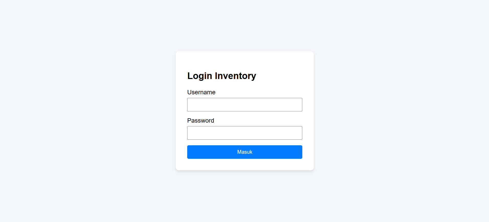
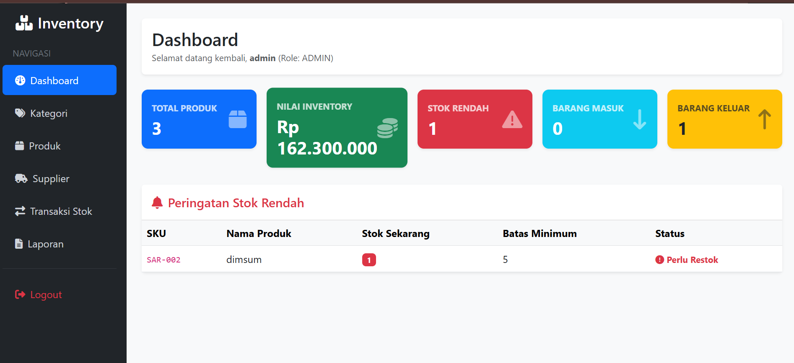
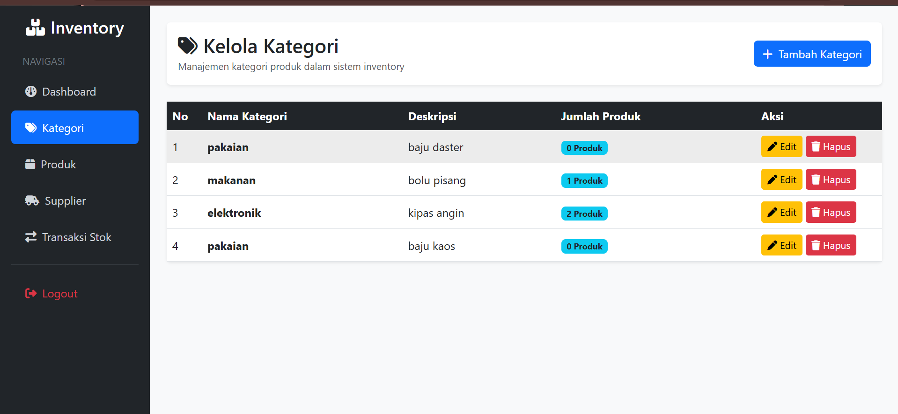
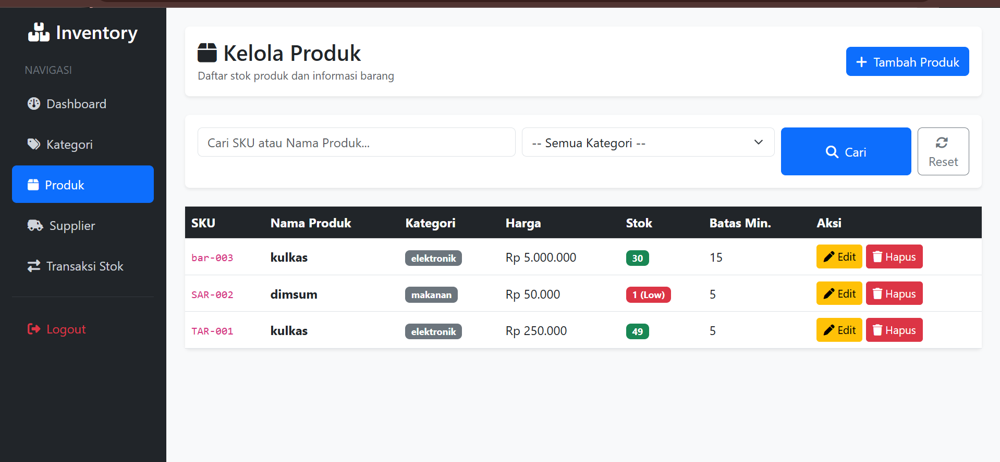
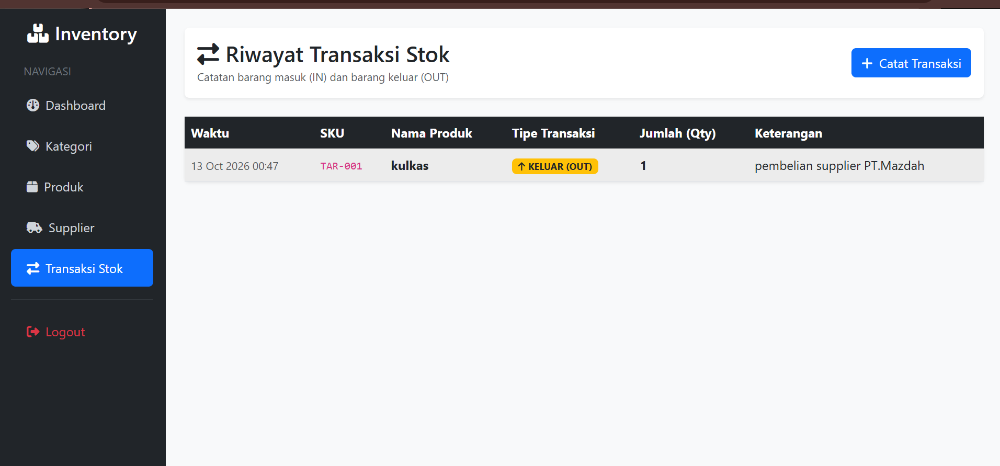
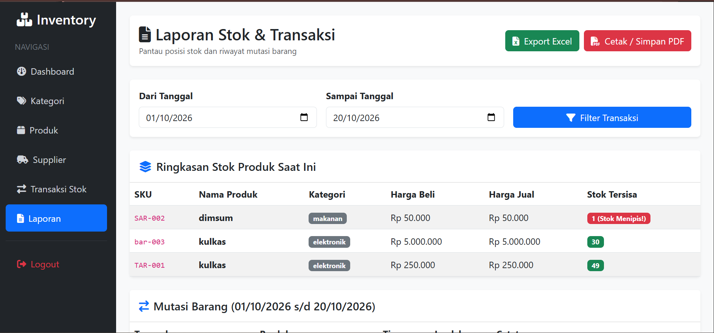

# 📦 Inventory Management System (PHP & MySQL)

Sistem Informasi Manajemen Inventaris Barang berbasis web yang dirancang untuk mengelola data produk, kategori, supplier, riwayat transaksi stok (masuk & keluar), serta pencatatan laporan yang dilengkapi fitur cetak PDF dan export Excel.

---

## 🚀 Fitur Utama

- **Dashboard Dynamic**: Menampilkan total produk, nilai inventaris, jumlah barang masuk/keluar, serta peringatan otomatis (*Low Stock Alert*) untuk stok yang menipis.
- **Manajemen Kategori**: Kelola data kategori barang (Tambah, Edit, Hapus, Lihat).
- **Manajemen Produk**: Kelola katalog produk beserta harga, stok, dan batas minimum stok.
- **Manajemen Supplier**: Kelola data pemasok barang beserta informasi kontak.
- **Transaksi Stok (IN/OUT)**: Pencatatan mutasi barang masuk dan keluar dengan sistem transaksi database yang aman.
- **Laporan & Export**:
  - Filter transaksi berdasarkan rentang tanggal.
  - Export laporan ke format **Microsoft Excel (`.xls`)**.
  - Cetak laporan / simpan ke format **PDF** melalui *native print browser*.

---

## 🛠️ Teknologi yang Digunakan

- **Backend**: PHP (PDO / Native)
- **Database**: MySQL / MariaDB
- **Frontend**: Bootstrap 5, FontAwesome 6, HTML5, CSS3

---

## 📁 Struktur Folder Project

```text
inventory-app/
├── app/
│   └── Helpers/
│       ├── auth.php         # Helper autentikasi & session check
│       └── escape.php       # Helper fungsi e() untuk keamanan XSS
├── config/
│   └── database.php     # Koneksi PDO ke MySQL
├── views/
│   ├── auth/
│   │   ├── login.php        # Halaman Login
│   │   └── logout.php       # Proses Logout
│   ├── categories/
│   │   ├── index.php        # Daftar Kategori
│   │   ├── create.php       # Tambah Kategori
│   │   ├── edit.php         # Edit Kategori
│   │   └── delete.php       # Hapus Kategori
│   ├── products/
│   │   ├── index.php        # Daftar Produk
│   │   ├── create.php       # Tambah Produk
│   │   ├── edit.php         # Edit Produk
│   │   └── delete.php       # Hapus Produk
│   ├── suppliers/
│   │   ├── index.php        # Daftar Supplier
│   │   ├── create.php       # Tambah Supplier
│   │   ├── edit.php         # Edit Supplier
│   │   └── delete.php       # Hapus Supplier
│   ├── stock/
│   │   ├── index.php        # Riwayat Transaksi Stok
│   │   └── create.php       # Catat Transaksi Stok Masuk/Keluar
│   ├── reports/
│   │   ├── index.php        # Halaman Utama Laporan
│   │   ├── export_excel.php # Script Export ke Excel
│   │   └── print.php        # Tampilan Cetak / Save PDF
│   └── dashboard.php        # Ringkasan Statistik Utama
└── README.md


---

## 📸 Tampilan Aplikasi (Screenshots)

### 1. Halaman Login


### 2. Dashboard Utama


### 3. Data Kategori


### 4. Data Produk


### 5. Transaksi Stok (Masuk & Keluar)


### 6. Laporan Inventory
